<!-- DEVVERSE:LANDING  (this page is replaced by your generated profile README after you edit config.yml) -->

# DevVerse
### Premium animated GitHub profile template for CSE students

**Fork. Edit one file. Go live.**

> ## ⭐ Enjoying DevVerse?
> **Please [star this repository](https://github.com/Muhtasim-Masum-Hasnayen/devverse-profile)** and **[follow @Muhtasim-Masum-Hasnayen](https://github.com/Muhtasim-Masum-Hasnayen)** — it is free and it really helps this project reach more students. Thank you! 💚

---

## ✨ What you get

| | |
|---|---|
| 🖥️ **Animated hacker banner** | Matrix rain, scrolling grid, glitch name effect |
| ⌨️ **Typing intro** | Rotating roles that type & erase |
| 🧑‍💻 **Terminal card** | `whoami`, `cat skills.txt`, `ls projects/` typed live |
| 🌙 **"Coding at night" scene** | Scrolling code, glowing keyboard, steaming coffee, live net-monitor |
| 🛡️ **Cyber lab terminal** | Matrix rain + hacker boot log |
| 📊 **Stats, streak, activity graph** | All colour-matched to your theme |
| 🐍 **Contribution snake + 3D graph** | Auto-updated by GitHub Actions |
| 😄 **Daily dev joke** | Fresh every day |
| 🎨 **5 themes** | `matrix` · `cyberpunk` · `dracula` · `tokyo` · `ocean` — change one line |

## 🎨 Themes

<table>
<tr>
<td align="center"><b>matrix</b> </td>
<td align="center"><b>cyberpunk</b> </td>
</tr>
<tr>
<td align="center"><b>dracula</b> </td>
<td align="center"><b>tokyo</b> </td>
</tr>
<tr>
<td align="center" colspan="2"><b>ocean</b> </td>
</tr>
</table>

## 🚀 Setup in 5 steps (no coding needed)

1. Click **Use this template → Create a new repository**.
2. **Name the repository exactly the same as your GitHub username** (e.g. `alexcarter/alexcarter`) and make it **Public**.
3. Open `config.yml` → change `github_username` to yours, fill in your name, skills, socials, pick a `theme`.
4. Go to **Settings → Actions → General → Workflow permissions → "Read and write permissions"**, then **Actions** tab → run **Build Profile**, **Contribution Snake**, **3D Contribution Graph** once.
5. Visit your profile — it is live. ✅

Full guide with troubleshooting: **[SETUP.md](SETUP.md)**

## ❤️ Support the creator

If this template saved you time, please:

- ⭐ **Star this repo**
- 👤 **[Follow @Muhtasim-Masum-Hasnayen](https://github.com/Muhtasim-Masum-Hasnayen)**
- 🔁 Share it with your CSE friends

Every profile built with DevVerse carries a small *"crafted by @YOUR_USERNAME"* credit and a star/follow button — that is the only thing asked in return (see [LICENSE](LICENSE)).

## 📄 License

DevVerse License (MIT + Attribution) — free to use, modify and share; the creator credit must stay. See [LICENSE](LICENSE).

Made with 💚 by <a href="https://github.com/Muhtasim-Masum-Hasnayen">Muhtasim Masum Hasnayen</a>

